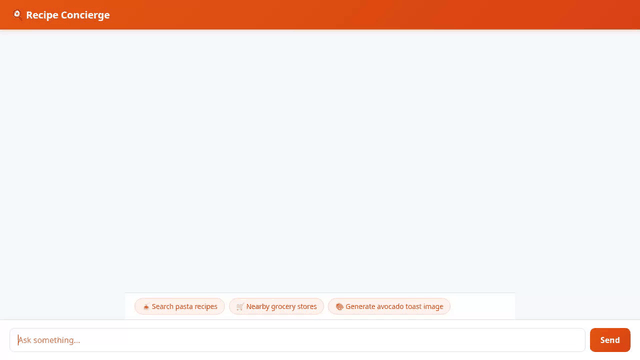

# 🍳 Recipe Concierge

An intelligent AI recipe assistant built on Google Agent Development Kit (ADK), Agent Runtime, and Vertex AI. **Recipe Concierge** helps users search, scale, and save recipes, locate nearby grocery stores, generate dish photos & short videos, and remember personal dietary preferences across sessions.



---

## 🚀 Key Features & Implemented Tools

Recipe Concierge is powered by an ADK ReAct agent (`app/agent.py`) equipped with the following tools and capabilities:

### 📖 Recipe Management & Firestore Database
- **Search Recipes (`search_recipes`)**: Queries Google Cloud Firestore for saved recipes matching keywords, cuisine, or ingredients.
- **Recipe Details (`get_recipe_details`)**: Retrieves complete recipe details, ingredient lists, and step-by-step instructions.
- **Add Recipe (`add_recipe`)**: Saves new recipes to the Firestore database.
- **Serving Scaling (`calculate_recipe_scaling`)**: Dynamically computes scaled ingredient quantities for any desired serving size.

### 🌐 Online Discovery & Local Grocery Stores
- **Web Recipe Ideas (`fetch_online_recipe_ideas`)**: Fetches online recipe recommendations from TheMealDB API.
- **Geocoding (`geocode_address`)**: Converts street addresses or city names into latitude/longitude coordinates.
- **Nearby Grocery Search (`find_nearby_places`)**: Finds local grocery stores, markets, and food shops using the Google Places API (New).

### 🎨 Multimodal Media Generation & Cloud Storage
- **Dish Photo Generation (`generate_recipe_image`)**: Generates high-quality dish imagery using `gemini-3.1-flash-lite-image` in global region. Saves output to ADK `ToolContext` artifacts and uploads to a public Google Cloud Storage bucket.
- **Dish Video Generation (`generate_recipe_video`)**: Generates short recipe preview videos using `gemini-omni-flash-preview` in global region via the Interactions API. Saves output to ADK `ToolContext` artifacts and uploads to public Google Cloud Storage.

### 🧠 Memory, Code Execution & Rich UI
- **Cross-Session Memory Bank**: Integrates Vertex AI Memory Bank (`PreloadMemoryTool` & memory-generation callbacks) to remember dietary restrictions, favorite cuisines, and user preferences across sessions.
- **Python Code Execution Sandbox**: Executes custom Python calculations dynamically via `BuiltinCodeExecutionTool`.
- **A2UI Rich Surface Renderer**: Emits structured A2UI (v0.8) display cards natively in the web UI.

---

## 🛠️ Google Cloud Services Infrastructure

Recipe Concierge integrates directly with the following Google Cloud services:

- **Vertex AI Agent Engine / Agent Runtime**: Deployed ADK reasoning engine hosting the agent runtime.
- **Google Cloud Firestore**: NoSQL database backing the recipe store (`recipes` collection).
- **Google Cloud Storage**: Public bucket (`recipe-concierge-images-591a0567`) serving generated dish images and videos.
- **Vertex AI Memory Bank**: Managed memory service for long-term user profile persistence.
- **Google Maps & Places API**: Location services for geocoding and grocery store lookup.

---

## 💻 Setup & Local Development

### Prerequisites

Ensure you have the following installed:
- **Python 3.10+** and **uv** (`pip install uv`)
- **google-agents-cli** (`uv tool install google-agents-cli`)
- **Google Cloud SDK** (`gcloud`)

### 1. Install Dependencies

```bash
agents-cli install
```

### 2. Configure Environment Variables

Create or update `.env` with your project configuration:

```env
GOOGLE_GENAI_USE_VERTEXAI=true
GOOGLE_CLOUD_PROJECT=your-gcp-project-id
GOOGLE_CLOUD_LOCATION=global
GOOGLE_MAPS_API_KEY=your-google-maps-api-key
```

### 3. Run Locally

#### Option A: ADK Developer Playground

Launch the local ADK Web playground with auto-reloading:

```bash
agents-cli playground
```

#### Option B: FastAPI Proxy & Custom Frontend

Start the proxy server and chat frontend:

```bash
AGENT_ENGINE_RESOURCE_NAME="projects/YOUR_PROJECT_ID/locations/us-east1/reasoningEngines/YOUR_ENGINE_ID" \
AGENT_DIRECTORY="app" \
uv run python frontend/main.py
```

---

## 🚢 Deployment

Deploy the agent to Vertex AI Agent Runtime:

```bash
gcloud config set project your-gcp-project-id
agents-cli deploy --project your-gcp-project-id --region us-east1 --update-env-vars GOOGLE_MAPS_API_KEY=your-api-key
```
